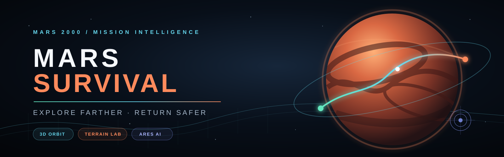
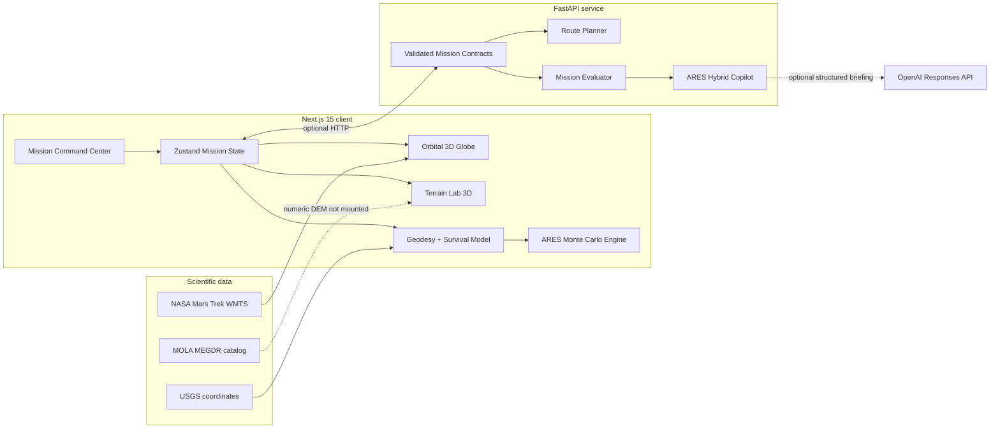

<p align="center">
  
</p>

<p align="center">
  <strong>AI-assisted Mars expedition planning and survival intelligence</strong><br>
  <em>Explore the planet, model uncertainty, protect the crew, and plan the return.</em>
</p>

<p align="center">
  
  
  
  
  
  
</p>

<p align="center">
  <a href="#-quick-start">Quick start</a> ·
  <a href="#-mission-capabilities">Capabilities</a> ·
  <a href="#-system-architecture">Architecture</a> ·
  <a href="#-api-reference">API</a> ·
  <a href="#-scientific-integrity">Scientific integrity</a>
</p>

---

## 🚀 Mission overview

**Mars Survival** is an interactive mission-planning platform for human exploration of Mars. It combines global route geometry, 3D planetary visualization, crew-resource modeling, deterministic simulation, uncertainty analysis, and an optional generative AI briefing layer.

The central question is simple:

> Can the crew reach the scientific objective and return to base while preserving oxygen, energy, water, time, radiation, and contingency margins?

The application is designed as an educational NASA Space Apps project. Every result distinguishes between **calculated facts**, **scenario assumptions**, and **missing scientific data**.

> [!IMPORTANT]
> Mars Survival is experimental planning software—not certified navigation, medical guidance, or operational mission control.

---

## 🧭 Mission capabilities

### 🪐 Advanced orbital operations

- Interactive 3D Mars globe using NASA Mars Trek MGS/MOLA imagery.
- Fresnel atmospheric glow, solar illumination, day/night terminator, orbital guides, Phobos and Deimos.
- Animated route telemetry, surface-oriented beacons, mission vehicle, landmarks, and cinematic/manual cameras.
- Full-planet 2D equirectangular map with a shared coordinate and route state.
- Planetocentric latitude and east-positive longitude following the Mars 2000 convention.

### ⛰️ Terrain Lab 3D

- Reproducible local terrain corridor with craters, ridges, and a route-following vehicle.
- Adjustable vertical exaggeration, contour mesh, and slope/roughness risk overlay.
- Longitudinal terrain and slope profile synchronized with the active route.
- Explicit **conceptual proxy** status until a numeric MOLA/HRSC DEM is mounted.

### 🧠 ARES mission copilot

- Reproducible Monte Carlo scenario engine that remains available offline.
- Simultaneous success probability across oxygen, energy, water, radiation, and time.
- Automatic limiting-factor detection and one-click configuration improvements.
- Natural-language mission questions and briefings.
- Optional OpenAI Structured Outputs integration; the model explains verified calculations but never replaces them.

### 🧑‍🚀 Survival and mission simulation

- Round-trip distance, duration, resource consumption, reserve, radiation, and contingency calculations.
- Crew size, speed, science time, consumptions, inventory, and limits remain editable.
- Four route objectives: direct, conservative, science, and resource-limited.
- Deterministic playback for outbound and return phases.
- JSON mission package, GeoJSON route, and PDF intelligence report exports.

### 🔬 Transparent science contract

- Global great-circle geometry with antimeridian and polar handling.
- Typed route-quality states: `global-geometric`, `mola-evaluated`, and `high-resolution-dem`.
- Missing numeric elevation returns `insufficient-data` / HTTP `501`; zero elevation is never fabricated.
- Terrain visualization effects never silently upgrade route safety.

---

## 🏗️ System architecture



### Technology stack

| Layer | Technology |
|---|---|
| Application | Next.js 15, React 19, TypeScript |
| 3D visualization | React Three Fiber, Three.js, Drei, WebGL |
| State | Zustand |
| Charts | Recharts |
| API | FastAPI, Pydantic, Uvicorn |
| AI | Deterministic Monte Carlo + optional OpenAI Responses API |
| Geometry | Mars great-circle interpolation + local A* foundation |
| Reports | jsPDF, JSON, GeoJSON |
| Delivery | Static Next.js export, Docker, Docker Compose |

More detail is available in [Architecture](docs/ARCHITECTURE.md) and [Verification](docs/VERIFICATION.md).

---

## ⚡ Quick start

### Requirements

- Node.js 20+
- npm 10+
- Python 3.11+ for the optional API

### Frontend

```powershell
git clone <your-github-repository-url>
cd Martian
npm.cmd install
npm.cmd run dev
```

Open [http://localhost:3000](http://localhost:3000).

Direct views:

- `http://localhost:3000/?view=globe`
- `http://localhost:3000/?view=map`
- `http://localhost:3000/?view=terrain`

### Optional FastAPI service

```powershell
py -m venv .venv
.venv\Scripts\python -m pip install -r api\requirements.txt
.venv\Scripts\python -m uvicorn api.main:app --reload --port 8000
```

Interactive API documentation: [http://localhost:8000/docs](http://localhost:8000/docs).

### Environment variables

Copy `.env.example` to `.env.local` for the frontend and provide backend variables in the API process environment.

| Variable | Required | Purpose |
|---|---:|---|
| `NEXT_PUBLIC_API_URL` | No | FastAPI base URL; defaults to `http://localhost:8000` |
| `NEXT_PUBLIC_MARS_TILE_BASE` | No | NASA Mars Trek WMTS tile override |
| `OPENAI_API_KEY` | No | Enables generative ARES briefings |
| `OPENAI_MODEL` | No | Structured-output model used by ARES |

Without an OpenAI key, the complete local ARES probability engine and recommendations continue to work.

---

## 📡 API reference

| Endpoint | Method | Description |
|---|:---:|---|
| `/api/health` | GET | Service status and enabled ARES capabilities |
| `/api/regions` | GET | Curated Mars locations and coordinate convention |
| `/api/layers` | GET | Configured scientific layers |
| `/api/terrain/elevation` | GET | Numeric elevation contract; returns `501` until DEM configuration |
| `/api/terrain/profile` | GET | Route elevation contract; returns `501` until DEM configuration |
| `/api/routes/plan` | POST | Plan a typed global-geometric route |
| `/api/routes/compare` | POST | Compare route strategies |
| `/api/mission/evaluate` | POST | Evaluate mission resources and constraints |
| `/api/mission/simulate` | POST | Generate the deterministic mission timeline |
| `/api/ai/mission-copilot` | POST | Run uncertainty analysis and optional AI briefing |
| `/api/science/locations` | GET | Curated science locations |
| `/api/datasets/status` | GET | Dataset configuration and availability |

### Example: evaluate a mission

```bash
curl -X POST http://localhost:8000/api/mission/evaluate \
  -H "Content-Type: application/json" \
  -d '{
    "route": {
      "coordinates": [{"lat": 18.38, "lon": 77.58}, {"lat": 18.65, "lon": 78.15}],
      "distance_km": 35.7,
      "strategy": "direct",
      "quality": "global-geometric",
      "terrain_evaluated": false,
      "warnings": ["Terrain not evaluated"]
    },
    "config": {"crew": 2, "return_required": true}
  }'
```

---

## 🧪 Verification

```powershell
npm.cmd test
npm.cmd run build
.venv\Scripts\python -m pytest api\test_main.py
```

The test suite covers geodesy, antimeridian and polar behavior, resource constraints, ARES reproducibility, conceptual terrain stability, API honesty, and local A* routing.

GitHub Actions runs frontend and backend verification on every pull request and push to `main`.

---

## 📁 Repository structure

```text
Martian/
├── app/                         # Next.js shell and global interface
├── components/
│   ├── AdvancedMarsGlobe.tsx    # Orbital WebGL scene
│   ├── TerrainLab3D.tsx         # Local terrain corridor
│   └── MarsCommandCenter.tsx    # Mission experience
├── lib/
│   ├── mars.ts                  # Geodesy and survival calculations
│   ├── terrain.ts               # Terrain proxy contract
│   ├── ares.ts                  # Offline uncertainty engine
│   └── store.ts                 # Shared mission state
├── api/                         # FastAPI contracts and services
├── data/                        # Scientific source catalog
├── tests/                       # TypeScript verification
├── docs/                        # Architecture and scientific limits
└── .github/                     # CI and contribution templates
```

---

## 🛰️ Scientific provenance

- [NASA Mars Trek WMTS](https://trek.nasa.gov/tiles/apidoc/trekAPI.html?body=mars) — global MGS/MOLA visual basemap.
- [NASA PDS MOLA MEGDR](https://pds.nasa.gov/ds-view/pds/viewDataset.jsp?dsid=MGS-M-MOLA-5-MEGDR-L3-V1.0) — authoritative gridded topography archive, catalogued but not mounted.
- [USGS planetary coordinate guidance](https://planetarynames.wr.usgs.gov/TargetCoordinates) — planetocentric latitude and east-positive longitude.

### Dataset status

| Product | Role | Status |
|---|---|---|
| MGS MOLA color hillshade | Global visual context | Configured |
| MOLA MEGDR numeric DEM | Elevation and slope | Catalogued, not mounted |
| Terrain Lab | UI and workflow preview | Conceptual proxy |
| Radiation | Editable constant-rate scenario | Not a live forecast |

---

## 🛡️ Scientific integrity

Mars Survival intentionally refuses to claim data it does not possess:

- Global routes are geometric, not terrain-certified.
- The Terrain Lab is visually useful but does not represent measured MOLA elevations.
- Radiation is a configurable exposure scenario, not current space-weather telemetry.
- Resource rates are transparent educational assumptions.
- “Favorable within model” never means “operationally safe.”

---

## 🗺️ Roadmap

- [ ] Mount and window-read a numeric MOLA MEGDR raster.
- [ ] Refine global routes with slope, roughness, and trafficability costs.
- [ ] Discover CTX/HiRISE coverage and load high-resolution DEM corridors.
- [ ] Add terrain-following camera and saved mission library.
- [ ] Implement server-side mission snapshots and collaborative mission review.
- [ ] Add offline scientific tile caching and cancelable backend jobs.

---

## 🤝 Contributing

Contributions are welcome. Read [CONTRIBUTING.md](CONTRIBUTING.md) before opening a pull request. Please preserve the project’s central rule: visual quality must never be presented as scientific certainty.

For security concerns, follow [SECURITY.md](SECURITY.md) instead of opening a public issue.

---

## 🌌 Acknowledgements

Built for the **NASA International Space Apps Challenge**, with data and guidance from NASA, the Planetary Data System, and the United States Geological Survey.

<p align="center">
  <strong>Explore farther. Return safer.</strong><br>
  <sub>Mars Survival · Educational and experimental mission intelligence</sub>
</p>
